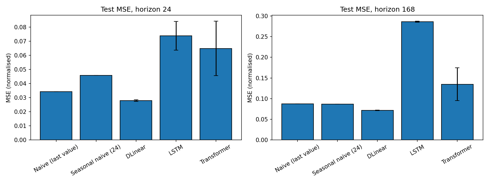
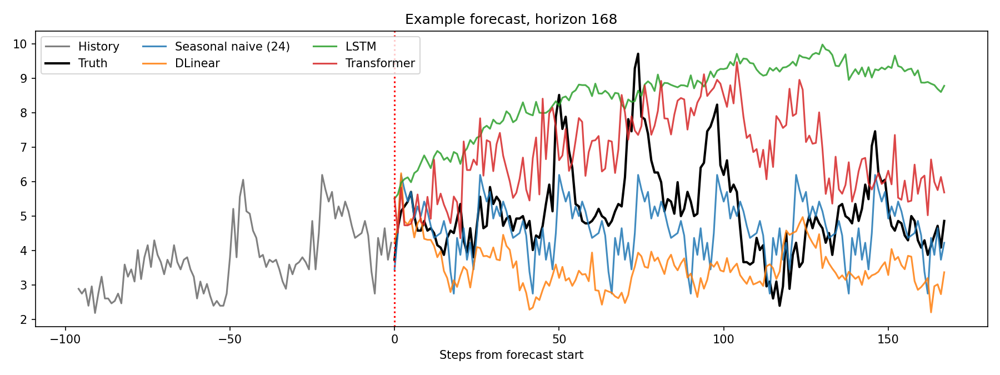
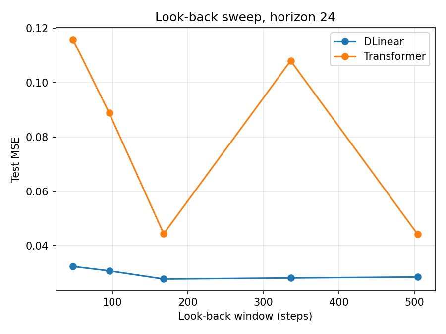
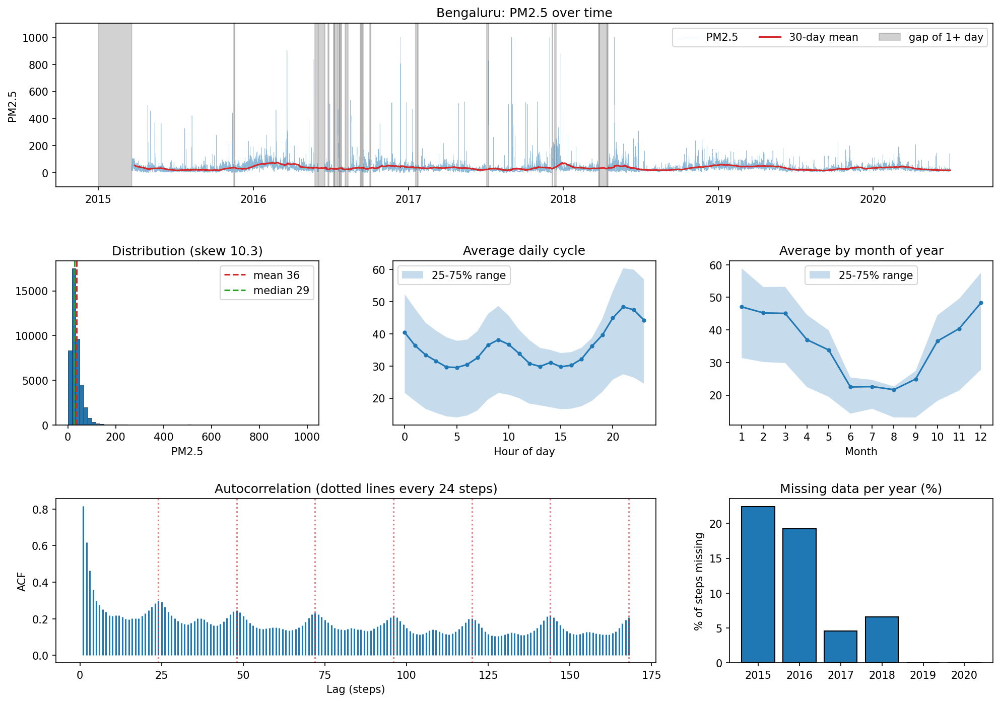

# Do Transformers Actually Beat a Linear Model at Time Series Forecasting?

Deep Learning mini project 2 of 3. This project re-examines the question raised by Zeng et al., *Are Transformers Effective for Time Series Forecasting?* (arXiv 2022, AAAI 2023): is a Transformer really better than a very simple linear model for forecasting?

**Short answer (on ETTh1, univariate target `OT`): no.** A tiny decomposition-plus-linear model (DLinear) had the lowest error at both horizons, with 8k to 57k parameters. A vanilla Transformer with 336k to 1.9M parameters was 1.9 to 2.3 times worse than DLinear, was less stable across seeds, and did not beat the naive "repeat the last value" baseline.

---

## 1. Setup

| Item | Choice |
|---|---|
| Dataset | ETTh1 (hourly electricity-transformer data), first 14,400 rows, univariate target `OT` (oil temperature) |
| Split | 60 / 20 / 20 chronological: 8,640 train, 2,880 val, 2,880 test |
| Preprocessing | z-score using **train-only** mean and std (no leakage) |
| Windows | look-back **168** steps (one week), stride 1, horizons **24** and **168**; val/test windows take their inputs from the preceding split, so every val/test point is forecast (2,857 / 2,713 test windows) |
| Metrics | MSE and MAE on the normalised scale, plus MAE in original units (MAE x train std) |
| Seeds | 3 per trained model (0, 1, 2); tables show mean +/- std (population std, n = 3) |
| Training | Adam, lr 1e-3, batch 64, MSE loss, up to 30 epochs, early stopping (patience 5) on validation MSE, best-validation weights restored |

### Models

| Model | Description |
|---|---|
| Naive | repeats the last observed value |
| Seasonal naive (24) | repeats the last 24 hours |
| **DLinear** | moving-average decomposition (kernel 25) into trend and seasonal parts, one linear layer each |
| **LSTM** | 2 layers, hidden size 64, dropout 0.1, linear head on the last hidden state |
| **Transformer** | vanilla encoder: every time step is a token, d_model 64, 4 heads, 2 layers, feed-forward 128, dropout 0.1, pre-norm, learned positional embedding, flatten + linear head |

All trained models use the same optimiser settings and early-stopping rule. No model-specific tuning was done.

---

## 2. Main results (ETTh1, test set, look-back 168)

Lower is better. Bold marks the best in each column. "Time" is wall-clock seconds per run and is affected by early stopping.

### Horizon 24

| Model | MSE | MAE | MAE (orig. units) | Params | Time (s) |
|---|---|---|---|---|---|
| Naive (last value) | 0.0343 | 0.1394 | 1.279 | 0 | 0 |
| Seasonal naive (24) | 0.0458 | 0.1663 | 1.526 | 0 | 0 |
| **DLinear** | **0.0279 +/- 0.0005** | **0.1273 +/- 0.0013** | **1.168** | 8,112 | 3.7 |
| LSTM | 0.0739 +/- 0.0083 | 0.2182 +/- 0.0152 | 2.002 | 51,992 | 8.5 |
| Transformer | 0.0649 +/- 0.0158 | 0.1989 +/- 0.0259 | 1.825 | 335,896 | 23.7 |

### Horizon 168

| Model | MSE | MAE | MAE (orig. units) | Params | Time (s) |
|---|---|---|---|---|---|
| Naive (last value) | 0.0872 | 0.2288 | 2.100 | 0 | 0 |
| Seasonal naive (24) | 0.0871 | 0.2302 | 2.113 | 0 | 0 |
| **DLinear** | **0.0716 +/- 0.0007** | **0.2020 +/- 0.0013** | **1.854** | 56,784 | 3.6 |
| LSTM | 0.2863 +/- 0.0010 | 0.4591 +/- 0.0022 | 4.213 | 61,352 | 5.0 |
| Transformer | 0.1349 +/- 0.0324 | 0.2896 +/- 0.0424 | 2.657 | 1,884,328 | 12.6 |

### What the results say

1. **DLinear wins at both horizons.** It improves on the naive baseline by about 19% (H = 24) and 18% (H = 168), has the smallest seed-to-seed spread, and trains in a few seconds.
2. **The vanilla Transformer does not beat a linear model, or even the naive baseline.** At H = 24 its MSE is 0.0649 against 0.0279 for DLinear and 0.0343 for naive. At H = 168 it is 0.1349 against 0.0716 and 0.0872. Even its best seed (0.0457 at H = 24, 0.0893 at H = 168) is worse than DLinear's worst seed (0.0285, 0.0725).
3. **The Transformer is unstable across seeds.** Test MSE ranges from 0.046 to 0.084 at H = 24 and from 0.089 to 0.161 at H = 168. At H = 168 it stopped after only 6 to 7 epochs, which with a patience of 5 means validation error was best in the first one or two epochs.
4. **The LSTM is the worst model, especially at H = 168** (MSE 0.286, about 4 times DLinear). Its spread across seeds is tiny (+/- 0.001), so this looks like a systematic failure and not bad luck. In the example forecast it drifts well above the truth. The gap between the LSTM and the Transformer at H = 24 is within seed noise, so no ranking should be claimed there.
5. **Seasonal naive is not better than last-value on this target.** At H = 24 it is worse (0.0458 vs 0.0343) and at H = 168 the two are tied. The daily cycle in `OT` is weak (see the two-week plot in `data_overview.png`).
6. **More parameters did not buy accuracy.** The Transformer has about 41 times (H = 24) and 33 times (H = 168) the parameters of DLinear and was slower to train per run.

*Single test window, qualitative only: the LSTM and Transformer overshoot the truth, DLinear sits slightly low, and seasonal naive tracks the level.*

---

## 3. Does a longer look-back help? (horizon 24, one seed)

| Look-back | 48 | 96 | 168 | 336 | 504 |
|---|---|---|---|---|---|
| DLinear MSE | 0.0326 | 0.0310 | **0.0280** | 0.0284 | 0.0288 |
| Transformer MSE | 0.1158 | 0.0888 | 0.0446 | 0.1080 | **0.0444** |

- **DLinear** improves by about 14% from 48 to 168 steps, then stays essentially flat (0.0280 to 0.0288, a difference close to its seed spread of about 0.0005). In this setup it does not keep improving with a longer window beyond one week.
- **Transformer** results zig-zag with no clear trend. Each point is a single seed, and the seed-to-seed spread at look-back 168 alone (0.046 to 0.084) is as large as these swings, so the sweep cannot support a conclusion about the Transformer.
- The paper's broader claim (linear models gain from longer history, Transformers do not) is therefore only partly visible here, and the sweep is too noisy to confirm or refute it.

---

## 4. Supplementary: Bengaluru PM2.5 data exploration

The notebook also has a CSV option. The Bengaluru air-quality file (`city_hour.csv`, filtered to `City == "Bengaluru"`) was **explored but not used for the forecasting results above**; all models in Sections 2 and 3 were run on ETTh1 only.

- **Coverage:** 48,192 hourly steps from 2015-01-01 to 2020-07-01, 9.6% of PM2.5 values missing.
- **Gaps:** the longest gap is 1,883 hours (about 78 days) and sits at the start of the series in early 2015. Missing share per year: 2015 about 22%, 2016 about 19%, 2017 about 5%, 2018 about 7%, 2019 and 2020 0%. With the notebook's 70/10/20 split, train covers 2015 to about Nov 2018, so interpolation would only affect training data; the test period (about Jun 2019 to Jul 2020) is fully observed.
- **Distribution:** strongly right-skewed (skew 10.3; mean 36, median 29, spikes up to about 1000). The extreme spikes fall in the training period and would inflate the std used for normalisation, so MSE values on this data are not comparable with the ETTh1 ones.
- **Seasonality:** there is a daily pattern (morning bump near 09:00, higher evenings) and a yearly one (highest in Dec to Mar, lowest in Jun to Aug). The autocorrelation at 24-hour multiples is only about 0.2 to 0.3, against about 0.8 at lag 1, so the daily cycle is much weaker than short-term persistence.

---

## 5. Limitations

- **One dataset, one target, two horizons.** The paper reports horizons 96 to 720 on several datasets, so these numbers are not comparable with its tables. This is a small independent check, not a replication.
- **Few seeds.** Three seeds give a rough spread only, particularly for the Transformer. The look-back sweep uses a single seed.
- **Not bit-for-bit reproducible on GPU.** The same Transformer seed (0, look-back 168, H = 24) gave test MSE 0.0457 in the main run and 0.0446 in the sweep. DLinear matched exactly.
- **No hyperparameter tuning.** All models share one learning rate and no scheduler. The conclusion applies to this vanilla point-wise-token Transformer, not to newer designs (for example patch-based models), which may do better.
- **Distribution shift in ETTh1.** `OT` drifts downward over the series (see `data_overview.png`), so the test period sits at a different level from training. This favours persistence-style baselines and hurts models that regress towards the training mean.

---

## 6. Reproducing

1. Open `project2_forecasting_1.ipynb` in Google Colab (Runtime > Change runtime type > T4 GPU recommended).
2. Keep `DATA_SOURCE = "ett"` in the Config cell. ETTh1 is downloaded automatically.
3. Run all cells top to bottom (section 8, the look-back sweep, is optional, about 5 to 10 minutes).
4. For the city exploration cells, upload `city_hour.csv` when the section 0 cell asks. To forecast on it instead, set `DATA_SOURCE = "csv"`.

### Files

| File | Contents |
|---|---|
| `project2_forecasting_1.ipynb` | full notebook |
| `results_summary.csv` | table in Section 2 (mean +/- std) |
| `raw_results.csv` | every individual run (model, horizon, seed, MSE, MAE, params, time, epochs) |
| `lookback_sweep.csv` | data for Section 3 |
| `mse_comparison.png`, `example_forecast.png`, `lookback_sweep.png` | result figures |
| `data_overview.png` | ETTh1 split and two-week view |
| `city_data_overview.png` | Bengaluru PM2.5 exploration |

`city_hour.csv` (about 65 MB) is not included.

## Reference

Zeng, A., Chen, M., Zhang, L., Xu, Q. *Are Transformers Effective for Time Series Forecasting?* AAAI 2023 (arXiv preprint 2022).
The ETT dataset comes from Zhou et al., *Informer*, AAAI 2021.
